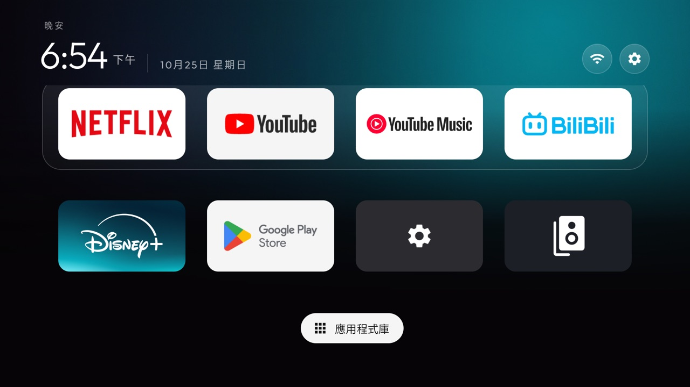
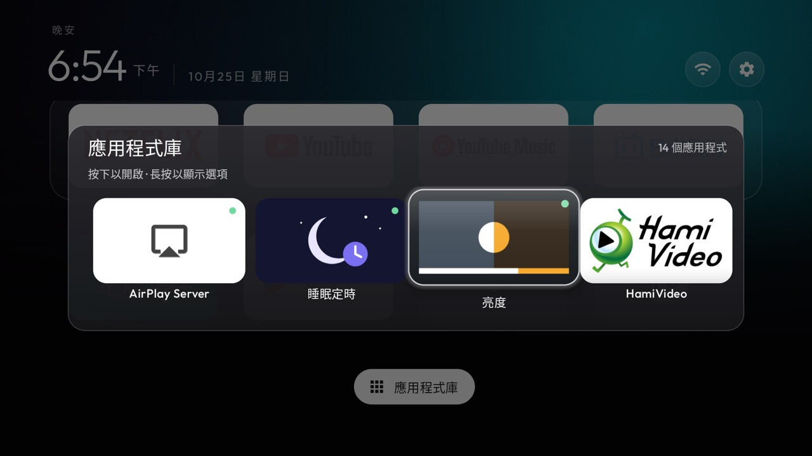

# Chromecast glass fork

This branch is [cleanyourtv](https://github.com/Gathin23/cleanyourtv) `main` plus a few changes I use on two
Chromecast with Google TV units. Everything else (the prompt, the debloat lists, the tools) is upstream's.
Tested on a Chromecast with Google TV 4K, Google TV 14 (UTTC.250917.004).




## What is different

| Change | Key or file | Upstream |
|---|---|---|
| The App library's cards are Home's tiles: banner or icon (`uniform_tiles` too), Home's zoom, corners and glass, a badge for apps on Home and new installs; OK opens with `library_ok_opens`, hold OK for Open, Add to / Remove from Home and App info | `library_home_tiles` | [PR](https://github.com/Gathin23/cleanyourtv/pulls?q=library_home_tiles) |
| The focus glass with less white sheen, for dark wallpapers; the library's glass follows it and `focus_overshoot` | `glass_haze` (0-100) | [#1288](https://github.com/Gathin23/cleanyourtv/pull/1288), closed: fork only |
| Remote buttons: a hold fires after half a second while the button is still down, each press opens one app even when two key services filter, and an `app_keys` entry can name an activity (`package/.Activity`) | `app_keys` | [#1287](https://github.com/Gathin23/cleanyourtv/pull/1287) |
| Brightness add-on: a quick bar over whatever is playing for a remote button, and night mode in one press | `addons/brightness` | [#1290](https://github.com/Gathin23/cleanyourtv/pull/1290) |
| Sleep Timer add-on: a quick bar for a remote button, bedtime in one press, zh-TW strings | `addons/sleep-timer` | [#1291](https://github.com/Gathin23/cleanyourtv/pull/1291) |
| A flat Settings banner (`banner_settings`) for `app_banners` | `drawable/banner_settings.xml` | fork only |

The library, glass and banner changes are off until `config.xml` or a theme turns them on. The remote-key
change applies wherever `app_keys` has a `hold:` entry: the hold app opens while the button is still held,
instead of on release. No network, no new permission, no background service.

## Build and try it

Build and install it the way upstream's README says (`launcher/build-and-install.sh`), then push a theme with
these keys added to its `config.json`:

```json
"app_library": true,
"library_ok_opens": true,
"library_home_tiles": true,
"glass_haze": 50,
"app_banners": ["com.android.tv.settings=banner_settings"],
"app_keys": ["hold:191:io.github.maxhayim.brightness/.QuickActivity",
             "178:io.github.luyzfernando08.sleeptimer/.BedtimeActivity"]
```

The `app_keys` keycodes are the ones my remote sends; read yours with `getevent` first.
